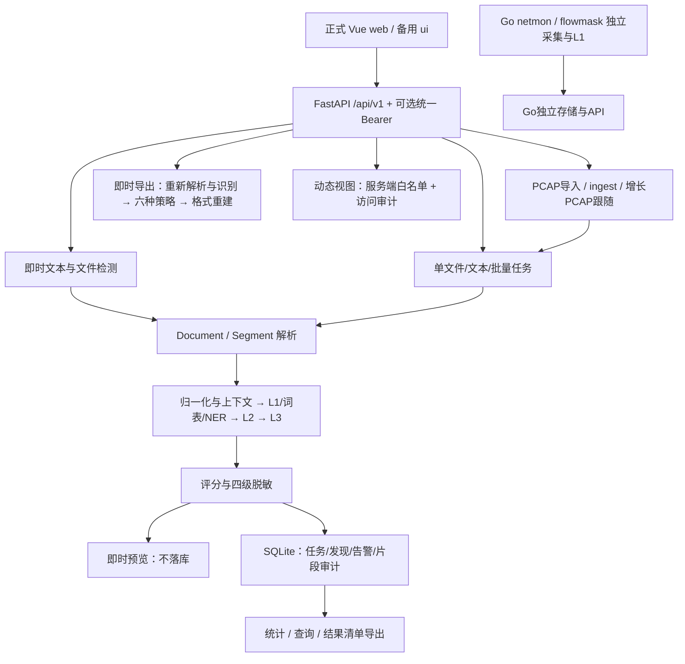

# FlowMask 后端业务全面审计

> 本文保留审计基线的缺陷证据。后续第一批核心修复已在`codex/backend-p0`实施，最新覆盖与未完成范围见[第一批交付](第一批P0修复交付-2026-11-05.md)，不要把下方历史实际行为当成修复后的行为。

审计日期：2026-11-05。代码基线：`73aaf10`。目标仓库：`datausing/`，不是相邻的旧版 `FlowMask/`。本轮交付为审计、复现证据与完善方案；**没有修复业务代码，下述问题仍然存在**。

## 1. 结论与审查边界

项目已经具备真实的解析、识别、脱敏、任务持久化、告警、审计和导出能力，不能简单归类为 UI 原型。但“能执行”与“安全闭环”之间仍有明显差距：部分输入没有进入识别，部分命中在合并时丢失，部分结构化输出没有实际替换敏感值，部分失败和截断没有反映在完成状态里。

最优先处理的是原文越过脱敏边界和检测不完整却表现为正常完成。尤其是：JSON 特殊键/CSV 重名列导出残留、动态未授权降级为 SAFE/L1、任务强制 L1 落库原值、网络 URL 元数据原样持久化。不要先做 UI 重设计或架构替换。

证据等级：

- **R（已复现）**：隔离数据库、合成文本/流量，通过真实函数或 TestClient 调用复现。模型错误分支使用可控替身，不代表真实模型准确率验证。
- **S（静态确认）**：已读实现和调用关系，代码明确缺失该行为；未声称实测全部环境。
- **U（未验证）**：真实 L2/L3/NER/OCR 权重、持续网卡旁路、桌面打包运行及模型准确率，不作已完成结论。

范围覆盖 Python API 与核心业务模块、正式 Vue 前端 API 消费、Go DLP/采集分支、模型服务装配与现有测试。未读取真实用户数据，未调用外部模型，未修改生产数据库。训练质量、所有部署平台和历史运维功能的逐行安全认证不属于本报告结论。

优先级：P0 = 阻止原文越过声称的脱敏/未授权边界；P1 = 错误业务结果或任务数据丢失；P2 = 可解释性、管理和能力完整性。它们是本项目修复顺序，不能等同于公网漏洞等级。难度为相对评估：低/中/高，不是工期承诺。

## 2. 当前业务架构

### 2.1 数据与职责

- `server/app/main.py:79` 装配 API、数据库、活动规则与插件。正式桌面入口为 `server/desktop.py`，正式界面在 `web/`；旧 `client/` 保留网络监控能力。
- `parsers/` 把输入变为 `Document/Segment`。片段有路径、文字、偏移和上下文 hint；它是识别与回写关联的基础，目前路径并非始终唯一。
- `identify/pipeline.py:278` 按片段识别，`analyze_segment:313` 归一化并映射回原文。`rules/scoring/masking` 分别承担规则、评分与四级替换。
- 引擎 L1/L2/L3 是处理层；风险 SAFE/L1/L2/L3 是输出等级。二者同名但不是同一概念，应在未来接口中明确区分。
- `tasks/service.py:55` 创建数据库任务并启动 daemon 线程。检测结束后，findings、告警、逐片段审计及 done 状态在同一事务写入，这是已经具备的可靠联动。
- `core/db.py:18` 持久化 tasks、findings、audit_log、rules、user_prefs、alerts。没有持久队列、任务取消标志、规则版本、完整命中详情表或受信主体权限表。
- 即时检测不落库；任务才进入历史统计。普通任务导出是 finding 清单，不等于原格式完整脱敏文件。即时文件导出会重新识别，不复用预览快照。
- 默认本地回环、可选共享 Bearer；操作人头主要用于演示与审计标记，不构成独立身份认证。设置页是只读配置说明，主题偏好可保存，不能当作模型配置管理后台。

### 2.2 真实能力与边界

L1 包含正则、校验位、词表、归一化、地名和部分编码识别；L2 是可选 HTTP 分类；L3 只复核灰区，不是每段必跑。NER 和 OCR 依赖可选本地能力。关闭或未执行的层级不能据此宣称“通过”。Go 和 Python 目前是两套 DLP 实现，并没有自动共享 Python 自定义规则、风险结果、任务和审计。

Python上传不会保存PCAP原件；live源PCAP仍由外部采集器持有，Go抓包导出也能写原始PCAP，因此“整个系统从不落原文”不成立。桌面exe只装配主服务，模型sidecar需要另行启动。L2服务默认mock，L3存在mock/auto回退；这些是明确存在的演示能力，不能当真实模型推理成果。建议生产模式禁止静默回退mock，保留测试/演示的显式模式。

## 3. 完整功能矩阵

| 功能模块 | 当前实现 | 业务完整性 | 存在问题 | 缺失能力 | 优先级 | 完善方案 |
| --- | --- | --- | --- | --- | --- | --- |
| 即时文本/文件识别 | 真实解析与逐片段管线；不落库 | 部分闭环 | 显式格式未使用；归一化误合并；解析失败回退不透明 | 输入完整性与格式警告 | P1 | F01、F09，统一解析入口 |
| L1 多规则识别 | 活动规则、校验、词表、区间 | 部分闭环 | 起点优先去重丢高危证据；PEM只取头 | 冲突证据与覆盖范围模型 | P1 | F02、F06 |
| L2/L3/NER | 真实客户端/工厂与可选后端 | 条件可用 | 默认开关覆盖请求；未执行/失败状态不全 | 每层执行状态、模型版本与能力探测 | P1 | F07、F08 |
| 风险评估 | 片段 score/level/types/evidence | 片段闭环 | 记录被拆字段后共现评分不同 | 记录/文档风险汇总与计数定义 | P1 | F10、F28 |
| 四级脱敏 | 正序区间单遍替换、原始输入不就地改写 | 部分闭环 | L1语义为保留原值，与持久化“无原文”冲突 | 持久化与外发最低策略 | P0 | F11、F12 |
| 六种策略 | block/partial/hash/generalize/pseudonym/encrypt | 有真实实现 | 预览和导出检测快照不同 | 固定命中集上的策略重算 | P0 | F13、F14 |
| JSON/CSV/SQL | 字段/单元格/字面量识别与重建 | 部分闭环 | 数字漏检、路径碰撞、SQL列错位 | 稳定片段ID和可验证回写 | P0 | F03～F05 |
| DOCX/PDF/XLSX/OCR | 有真实解析；依赖与部分限制提示 | 范围有限 | PDF200页截断无完整性声明；DOCX正文范围有限 | 覆盖范围/未解析区域说明 | P1 | F30；不擅自承诺全部格式 |
| 文本/文件任务 | pending/running/done/failed，真实持久化 | 部分闭环 | daemon、无取消/重试/恢复；选项快照不全 | 单机任务状态机、受限调度 | P1 | F17、F27 |
| 批量任务 | 每文件独立任务，解析失败隔离，最多20文件 | 部分闭环 | 调度异常仍能中断整批；成功仅表示提交 | 批次汇总、取消/重试/幂等 | P1 | F18 |
| PCAP/PCAPNG导入 | 真实帧解析、会话重组、HTTP/文本转统一任务 | 部分闭环 | 缺口拼接、会话合并、截断、元数据泄露 | coverage/unknown与来源安全定位 | P0 | F22～F24 |
| 增长PCAP跟随 | 本地线程跟随、窗口、去重与任务提交 | 部分闭环 | 停止未排空、任务失败未反映；首次读入无字节预算；示例路径错误 | 排空/丢弃反馈、真实终态关联、增量读取 | P1 | F25、F31、F32 |
| Go采集/CLI | 独立真实采集、逐包L1与存储 | 独立闭环 | 不共享Python规则/重组/任务/审计 | 明确能力范围，统一结果契约 | P1 | F26，先约定再接入 |
| 审计溯源 | HMAC链、独立验签、导出、任务片段与动态访问留痕 | 部分闭环 | 缺提交者/事件类型/版本/导出等事件；删尾边界 | 事件链路与可信锚点说明 | P1 | F19、F20 |
| 规则管理 | 新增/删除/启停/持久化/热替换活动元组 | 基础闭环 | 不能编辑内容、无版本/历史/优先级；耗时正则 | 更新协议、快照与执行预算 | P1 | F15、F16 |
| 动态授权与导出权限 | 白名单后端检查 + 全局可选Bearer | 演示模型 | 可降级脱敏；主体自报；无统一操作权限 | 受信主体与最小能力控制 | P0 | F11；完整模型列入第三批 |
| 统计与告警 | 查真实findings；告警和结果同事务；认领接口 | 有真实数据 | 安全片段不记数；单位混淆；前端未接告警处置 | 明确分母/命中数/片段数/完整性 | P1 | F28、F19 |
| 隐私增强导出 | 计数加噪、l-diversity检查、完整finding输出 | 算子存在，保障不闭环 | 精确计数和明细可还原加噪统计 | 明确的聚合发布模式与适用声明 | P1 | F21 |
| AI助手/场景模板 | 默认真实本地规则建议，可选模型；前端接入 | 基础闭环 | 建议不等于授权/已执行策略 | 执行前后策略绑定与版本 | P2 | 复用F14/F27，不让助手直接决定权限 |
| 插件/词表/偏好 | 注册表、解析器分派、只读词表、多操作人主题 | 范围有限 | 引擎登记不自动参与管线；available常仅为配置 | 实际调用能力描述、统一状态 | P2 | F29 |

后端存在而正式前端未使用的能力：`/alerts*` 的告警查询/认领、`/keywords` 的词表查询、`/plugins` 的插件登记信息、`/traffic/ingest` 的外部推送入口。后两类有开发/集成用途，不要求为了“覆盖率”全部做成页面。

未发现需要把整个当前正式界面归类为“纯假入口”的依据。实际缺口主要是有限实现、错误边界和缺少能力状态。前端已有的“模型开关”与真实执行存在偏差，普通导出入口也不能理解成所有格式之间自由转换。

## 4. 问题登记与验收

类别：A核心逻辑；B实现不完整；C模块联动；D数据/状态；E隐私权限；F性能稳定；G前端所需后端能力。每项方案均为待实施建议。

### F01 · A · P1 · 数字归一化吞掉独立字段（R，难度中）

位置：`server/app/identify/normalize.py:55`；`pipeline.py:326`。
当前：删除数字间空格/连字符，两个空格分隔手机号变为22位，原规则可识别2条，完整管线反而0条。预期：格式归一化不应损失原文有效命中。影响：常见名单漏检。
方案：限定单个候选范围和合理长度，同时检测原文候选并合并映射证据。验收：两个空格/制表符分隔号码各命中；单号码分组和全角仍正确；原文偏移无越界。

### F02 · A/E · P1 · 去重压掉更强秘密证据（R，难度中）

位置：`identify/rules.py:264-276`、`identify/masking.py:46`。
当前：按起点先保留，权重只在同起点起作用。邮箱内含合成 `sk-` 秘密时仅剩email/L1，L1副本保留完整秘密。预期：语义去重与替换覆盖分离，高危证据不丢失。影响：低估风险并保留秘密。
方案：确定风险/证据优先级，保留被压制来源，生成互不重叠的安全替换区间。验收：同起点、包含、交叉、相邻四类冲突不重复计数，不遗留敏感尾部。

### F03 · A/D/E · P0 · JSON路径歧义及数字值漏检（R，难度中）

位置：`parsers/json_parser.py:14,23`、`tasks/document_export.py:103,135,159,175`。
当前：只对字符串建片段；点/方括号/空键用显示路径不能可靠回写，甚至与嵌套结构碰撞。预览已掩码，block导出仍有原值。数字型手机号与普通字符串字段并存（如phone为数值、note为ordinary）时，JSON解析成功但数值字段跳过；纯数字JSON在粘贴入口可能退回文本并被命中，上传入口的表现也需分别验收。预期：唯一、类型明确的值定位，不能依赖偶然回退。
方案：内部使用路径token和片段ID，显示路径仅展示；覆盖数值标量，普通值保留类型；每项敏感替换都校验完成。验收：点/括号/空键/转义键/嵌套同名/数组/数值手机全部可定位，替换失败返回明确错误。

### F04 · A/D/E · P0 · CSV重名列回写错误（R，难度低）

位置：`parsers/csv_parser.py:45`、`tasks/document_export.py:182,197,203`。
当前：`phone,phone` 两列产生相同路径，字典覆盖，导出首列原号码。预期：按行列序号唯一定位。影响：真实表格敏感字段残留。
方案：列序号作内部ID，列名只作hint；明确无表头模式。验收：重名/空表头、引号、逗号、单元格换行、多敏感列均逐格正确。

### F05 · A/B · P1 · SQL列上下文错位（R，难度中）

位置：`parsers/sql_parser.py:40,97`。
当前：只计字符串字面量序号，混合数字/NULL时与列不对应；多行INSERT不按元组重置。`(id,password) VALUES(1,'abcdef123456')` 的密码被标hint=id，漏检。预期：按完整元组列序定位。影响：结构化秘密漏检和原文导出。
方案：复用现有扫描器补齐括号/引号状态与值索引，不盲目加入完整SQL执行引擎；不支持语法明确标记。验收：数字、NULL、函数、转义引号、多行INSERT不串列且输出可解析。

### F06 · A/E · P1 · PEM只识别边界头（R，难度低）

位置：`identify/rules.py:158`。
当前：只匹配PRIVATE KEY的BEGIN头，密钥主体与END在预览及block导出保留。预期：识别并处理整个秘密块。影响：私钥主体原样保留；真实有效私钥可能通过补回边界恢复，本轮只用合成PEM外形，未验证实际密钥可用性。
方案：多行完整块识别，规定缺END时保守范围。验收：不同PRIVATE KEY类型、CRLF、连续多个块、不闭合块均不输出秘密主体。

### F07 · A/C · P1 · 偏移重基丢语义分类与加分（R，难度低）

位置：`identify/pipeline.py:169,329`。
当前：重基时从L1命中重算，L2新增address证据仍在向量，最终types/score却消失；等价文本与结构化字段不同。预期：偏移变换不改变证据语义。
方案：定位与评估解耦，统一从保留的证据集合计算结果。验收：纯文本、字段hint、全角归一化后的语义类别与评分一致；向量与最终分类可复算。

### F08 · B/D/G · P1 · 引擎开关与失败状态不可信（R，难度中）

位置：`api/routes_detect.py:88,119,202`、`api/routes_tasks.py:50,80`、`identify/pipeline.py:270,398`、`identify/l2.py:75,95`、`identify/l3.py:169`。
当前：L2/L3请求false与服务端true用or合并，不能关闭；即时NER显式false已能覆盖默认值，但任务入口NER仍使用or。默认false时工厂不建相应客户端/NER实例，请求true仍可只跑L1且不标降级。HTTP L2连接失败也能得到degraded=false；L3失败已有正确降级分支。
预期：默认、允许使用、请求启用、实际执行分别表达；未执行不等于检查通过。方案：三态请求参数、独立能力与执行状态、超时/错误结构。验收：每层关闭时调用次数0；请求执行但不可用时明确unavailable/degraded；L1结果保留，不能称完整无风险。

### F09 · A/B/G · P1 · 显式格式被忽略，错误结构回退无说明（R/S，难度低）

位置：`api/schemas.py:21`、`api/routes_detect.py:86`、`parsers/registry.py:209`。
当前：即时检测忽略content_type；粘贴只尝试JSON再退文本，CSV/SQL注释与真实实现不符。格式错误JSON在粘贴时退纯文本，上传JSON则报解析错误。预期：显式格式严格解析，自动模式可回退但反馈原因。
方案：检测和导出共用解析入口，补detected_format/requested_format/warnings。兼容旧请求遗漏字段及旧text自动探测语义；新增明确的严格格式选择，或通过版本化契约区分显式格式，不能直接改变所有旧text请求。验收：显式csv/json/sql确实按对应格式处理；旧自动JSON探测仍可用；同内容同格式检测和导出命中一致；错误JSON明确error或fallback_warning。

### F10 · B/C · P2 · 风险只在片段内，缺记录与文档聚合（R/S，难度中）

位置：`identify/pipeline.py:278-307`、`api/schemas.py:66`。
当前：姓名+电话+邮箱在一段文本可共现升级，拆成同一JSON记录字段后分别评估；无document_risk。预期：保留片段评分，额外返回具有解释的记录/文档汇总。
方案：先以最高已知风险与完整性形成文档摘要，再单独定义同记录共现规则，不把所有文件内容一概加分。验收：同一记录两种表示有一致的汇总口径，不跨无关记录凑高危；风险来源可解释。

### F11 · E/A · P0 · 未授权动态副本可以保留原文（R，难度低至中）

位置：`api/routes_dynamic.py:79-106`、`identify/masking.py:34,71`、`api/deps.py:77`。
当前：白名单校验确实存在，但客户端mask_level=SAFE/L1先生成原值副本，未授权分支仍将它当masked返回。另白名单操作人来自可自报请求头，共享Bearer并不能证明此操作人身份。`api/routes_detect.py:247`解密入口没有复用原文查看白名单或写访问审计；若产品声称多角色隔离，持有密文的非白名单调用者仍可还原。动态接口样本来自请求方，不应把这项夸大为读取服务端未知原文。
预期：未授权输出必须满足最低掩码策略；身份由受信凭据决定。方案：先补不可降级的副本边界；第三批采用适合单机规模的凭据到能力映射，界面操作人仅作标签。验收：authorized=false且请求SAFE/L1、伪造操作人均不能取得原文；拒绝/放行有对应审计。单用户本机模式不需要擅自扩为企业账号平台。

### F12 · E/C · P0 · “不存原文”与任务L1策略矛盾（R，难度低）

位置：`api/deps.py:90`、`tasks/service.py:124-136`、`identify/masking.py:34`。
当前：只禁止任务强制SAFE，允许强制L1；L3身份证可被降为带低危前缀的原值落findings。默认实际L1本来也是保留原值。预期：持久化副本不因展示等级降低而失守。
方案：分离risk_level和mask_policy，为存储/外发强制至少安全掩码；低危警示原文仅留不持久化的本机预览。验收：任务与导出字段/错误不含合成原敏感值；风险仍为真实等级。扫描历史库只能报潜在旧数据，不能擅自删除用户数据。

### F13 · A/E · P0 · 不支持的格式组合静默原文输出（R，难度低）

位置：`tasks/document_export.py:54,225,450`、`api/routes_detect.py:237`。
当前：JSON输入选择SQL输出，SQL重建依赖SQL绝对offset；非SQL片段被跳过，最终返回原JSON敏感值。预期：明确支持的输入/输出组合，不支持就拒绝。
方案：格式能力矩阵；完整回写校验；不要为满足任意fmt暗中转为原始内容。验收：所有输入×fmt组合要么正确脱敏且可解析，要么4xx明确不支持，绝不200原文回退。

### F14 · C/D/E · P0 · 导出重新识别，不绑定检测快照（R，难度中）

位置：`api/routes_detect.py:190-243`、`web/src/views/DetectView.vue:344-383`。
当前：前端保留输入/部分选项，但导出再次调用当前活动规则与模型。检测命中自定义规则后停用该规则，block导出200且包含原值。策略变更也无法证明基于同一命中集合。
预期：预览与导出共享来源版本、有效选项和命中集；重检必须是明确动作。方案：指纹校验先发现已知规则/输入/选项漂移并返回409；要保证一致输出，仍须短寿命内存句柄绑定不可变命中集合，不能重新调用模型后声称相同快照。句柄不可猜测、绑定可信会话/主体，每次访问重新授权，缓存受条数/字节预算与TTL约束，不将原文持久化。验收：已知漂移明确报错；不可变命中集接入后，换策略仅改变替换方式，导出不重跑识别；过期或越权句柄不可用。

### F15 · B/D/G · P1 · 规则缺编辑、版本和变更历史（R/S，难度中）

位置：`api/routes_rules.py:33,95,121,133,168`、`api/schemas.py:190`。
当前：新增/删除/启停真实生效，错误编译规则被拒绝；启动跳过脏规则。PATCH只接enabled，附带pattern却200忽略；没有类别优先级、修订号、变更审计。活动元组按片段读取，长任务缺固定规则快照。
预期：明确可编辑字段与生效版本，运行中任务行为可重放。方案：兼容启停PATCH，增加明确更新模型、并发版本检查和规则集hash；保存无原文的变更事件。验收：编辑真实生效；未知字段不能假成功；运行中任务使用固定版本，后续任务使用新版本。

### F16 · F/E · P1 · 合法耗时正则无执行预算（R，难度中）

位置：`api/schemas.py:219-228`、`identify/rules.py:228`。
当前：仅编译校验和500字符模式长度限制；`(a+)+$` 被201接受，31字符合成非匹配文本在独立进程中超过1秒。预期：单规则不能无限占用检测线程/进程。
方案：限制输入与候选范围，拒绝明显危险构造，并选用可中断执行机制或受限工作进程；单纯正则黑名单不算完整保护。验收：恶劣模式在约定预算内失败/隔离，返回规则ID和降级信息，其余任务仍能完成。临时探针有1秒外部硬超时，未在实际服务中挂死线程。

### F17 · B/D/F · P1 · 任务生命周期缺恢复、取消、重试与限并发（R/S，难度中）

位置：`tasks/service.py:55-92,101-180`、`core/db.py:18`、`main.py:71`。
当前：每任务一个daemon，状态只有四种；重启后running不变；进程退出可能失去内存中的文档，无安全恢复依据。预期：任务终态可信、可取消，异常退出可解释。
方案：单进程有界执行器+取消令牌；启动将遗留非终态转interrupted；因为没有保存原文，重试需要重新提交来源，不伪装自动恢复。保持旧done状态兼容。验收：取消不再写后续结果；崩溃重启无永久running；重复提交可选择幂等键；队列满明确反馈。

### F18 · B/C/D · P1 · 批量只隔离输入失败，未隔离调度失败（R，难度中）

位置：`api/routes_tasks.py:103-170`、`tasks/service.py:84-91`。
当前：坏文件/超限可单独失败，已实现；但第二次Thread.start抛异常可使整请求500，首任务done、第二pending、第三未提交。批次“成功”也只表示提交，不是处理成功。
方案：每文件覆盖解析、持久化、入队、执行终态；返回item级状态，批次结果按任务终态汇总；失败补偿不得丢任务ID。验收：三文件中间解析失败与中间入队失败均不阻断第三文件；最终可区分partial_success、failed、cancelled。

### F19 · C/E/D · P1 · 审计链有效，但业务事件链不完整（R/S，难度中）

位置：`tasks/service.py:149`、`api/routes_tasks.py:28,67,209,233`、`api/routes_rules.py:121`、`alerts.py:178`、`audit/chain.py:38`。
当前：finding/告警/片段审计同事务可靠；任务没有传操作人，带头创建仍system/local。普通/即时/隐私导出、规则变更、告警处置没有对应业务事件；无命中的成功任务也无片段审计。现存task_id不能定位具体finding或替换版本。
方案：扩展兼容事件类型、主体、task_id/finding_id、ruleset/policy版本及结果指纹；创建/完成/失败/取消/导出准备等明确事件。流式下载只能证明服务端准备/发送，不能假称用户成功保存。验收：成功、无命中、失败、拒绝、策略变更、导出均可按关联ID追踪，审计中不放原值。

### F20 · E/G · P2 · 哈希链不能独自证明末尾未删除（R，难度低至中）

位置：`audit/chain.py:236-295`、`api/routes_audit.py:83-85`。
当前：删除末条后verify仍ok，全部删除后ok/total=0；只校验现存链。导出Head可由调用方保存，但无持久可信末尾锚点。预期：准确解释“内容链校验”和“完整性证明”的区别。
方案：先收窄宣传与响应状态；可选另存链头快照与备份校验。若要求抵御同时修改本地库和锚点的攻击，需要外部可信保存，属范围建议而非本轮擅自引入服务。验收：有可信锚点时能识别删尾；没有时明确未验证历史完整性，兼容旧签名。

### F21 · A/E · P1 · 隐私导出同包暴露精确分布（R，难度中）

位置：`privacy.py:96-169`、`tasks/export.py:59`。
当前：计数加Laplace噪声，但meta含精确total、findings含全部明细，能直接重算精确分布；l不满足仍200返回原明细。预期：把算子演示、检查报告与具有发布保证的模式区分。
方案：先明确保障范围；增加只含聚合统计的发布模式，去掉可复算明细/精确计数；l检查不满足时阻止受保护明细发布或明确不提供匿名保障。验收：发布包无法从其他字段重构加噪前分布；参数、失败状态和适用数据模型准确。当前finding分类不等于个人记录，不能宣称已完成人级差分隐私。

### F22 · E/C · P0 · 流量来源路径泄露原始URL参数（R，难度低）

位置：`traffic/streams.py:49,111`、`traffic/importer.py`、`traffic/live.py:501`。
当前：HTTP URL含合成身份证，正文同号被遮蔽，但完整URL进入finding.path并从查询返回。预期：元数据同样执行最小暴露；检测覆盖URL和所声明的请求区域。
方案：路径使用安全来源ID、方法与去参数路由摘要；必要URL/query/header作为单独检测片段，原始URL不作可持久化标签。验收：任务/审计/告警/path/source/export不含合成参数原值，仍可关联帧与消息序号。

### F23 · A/D · P1 · TCP重组混会话与跨缺口拼接（R，难度中至高）

位置：`traffic/streams.py:57,87`。
当前：同五元组两个连接同初始seq可只保留一条消息；seq100与1000的两段直接相连，895字节缺口不标记，甚至拼成虚假手机号。预期：连接世代、序列范围和完整性参与重组。
方案：加入SYN/FIN/RST/空闲世代边界与缺口状态；不把缺口两侧当连续正文。验收：端口复用、乱序、重传、交叠、缺口、seq回绕都有明确结果与coverage；不支持的情况返回partial/unknown。

### F24 · B/D/F · P1 · 截断与不可解析区域未计入完成状态（R，难度中）

位置：`traffic/streams.py:15,80,134`、`traffic/pcap.py`、`api/routes_traffic.py`。
当前：1,048,603字节会话截为1MB，敏感后缀丢失，error为空；HTTP声明1000字节只有hello仍接受；明文与opaque混合只处理可解部分；残缺pcap尾记录可被视为EOF。预期：资源限制合理，但必须声明丢弃范围。
方案：返回总帧/解析/跳过/加密/截断/缺口统计及原因，不把无正文等同SAFE；PCAP与PCAPNG离线/跟随统一支持矩阵。验收：超限、坏尾、加密流、残缺HTTP均产生partial/unsupported/unknown；已检出风险保留，不能宣称全文件安全。

### F25 · B/C/D · P1 · live停止丢积压，任务失败仍显示正常提交（R，难度中）

位置：`traffic/live.py:397,452,506` 及批提交/任务回收函数。
当前：181条待提交，停止只提交120条，余61条仍在内存，running=false/error空且可clear；异步任务failed后仍显示tasks=1、segments=1、last_error空。预期：已接受/已提交/已完成分别计数，停止有清晰语义。
方案：停止可控排空或明确报告discarded；追踪任务真实终态，失败不能计completed；禁止清理未报告待处理内容。验收：大于两窗口的停止无静默丢失；后台失败在live摘要可见；重启声明会话已中断。

### F26 · C/B · P1 · Go与Python检测口径未统一（S，难度中）

位置：`cmd/flowmask/main.go`、`internal/dlp/`、`internal/app/`、`server/app/api/routes_traffic.py`。
当前：Go独立逐包L1与存储；未发现自动调用Python ingest的桥接。Python规则管理和模型不影响Go实时采集结果。预期：能力范围准确，统一业务入口或兼容事件契约。
方案：先标注Go L1-only及独立数据源；第四批复用既有ingest接入完整消息和安全来源信息，不复制更多识别逻辑。验收：同合成消息经导入与桥接得到一致类别/风险/任务关联；原有Go CLI功能保留。

### F27 · D/G · P1 · 结果/任务缺完整选项与证据快照（S，难度中）

位置：`tasks/service.py:66-74`、`core/db.py:33-48`、`api/schemas.py:42,94`。
当前：任务options只保存L2/L3/mask/min，缺NER/词表/规则版本；持久化finding不保存spans/reason/direct；即时spans有位置/类别/规则但缺逐命中风险、置信度、引擎来源。预期：历史结果可解释，未来前端不必猜来源。
方案：向后兼容增加effective_options、ruleset_revision、policy_revision、coverage、hit明细和引擎执行记录；历史缺失为unknown，禁止补造旧结果。验收：API与落库能对齐任务、片段、命中、策略、模型和异常，偏移单位显式为Unicode code point。

### F28 · A/D/G · P1 · 统计真实但单位和分母不完整（R/S，难度低至中）

位置：`tasks/service.py:250-285`、`identify/pipeline.py:336`、`web/src/views/StatsView.vue:255,265`。
当前：无命中片段返回None，不落findings；SAFE为0不表示没有安全片段。两任务（一无命中、一片段两手机号）得到findings=1、phone.count=1；这是片段数而非命中次数。task_id过滤统计时tasks仍为全局2。
方案：明确tasks/processed_segments/sensitive_segments/hit_count/distinct_types/unknown_segments；按过滤条件统计相同范围。计数直接来自同一业务事实，不能另维护不一致副本。验收：上述样本tasks=2、processed_segments=2、sensitive_segments=1、hit_count=2；单任务范围tasks=1；未检查/丢弃不计为安全。

### F29 · B/G · P2 · 插件登记和配置状态不等于参与检测（R/S，难度低至中）

位置：`plugins.py:90,193,221,227`、`api/routes_plugins.py:17`、`api/routes_health.py:24`、`identify/pipeline.py:270`。
当前：解析器注册会进入真实分派；引擎/算子factory主要登记展示，未发现由注册表自动选中执行。L2/L3 available及health开关主要为配置值。缺权重时L2 health可以ok=true而ready=false；L3 health可status=ok而未加载模型。`l2_service/backends.py:297`默认mock，`l3_service/backends.py:465`有auto回退；主结果没有完整模型执行记录。预期：把registered/configured/ready/executed及real/mock分开。
方案：先准确返回能力信息和限制，启动脚本检查已启用sidecar的ready；非演示模式禁止静默mock替代。若要支持引擎替换，再设计显式配置选择与兼容契约。验收：缺权重/sidecar停机不能宣称模型就绪；未参与插件不得显示已执行；坏插件有warning，已有内置链不被注册表误覆盖。

### F30 · B/D/G · P1 · 文档检测范围不完整但缺覆盖声明（S，难度低至中）

位置：`parsers/pdf_parser.py:15,39,49,83`、`parsers/docx_parser.py:61-91`、`identify/ner.py`。
当前：PDF最多200页，meta仅记录实际处理页数；DOCX只取正文直接段落/表格，不覆盖页眉页脚等；NER token后端存在截断。预期：部分解析必须声明限制，不等同全文安全。
方案：先增加总页数/已处理区域/截断/无文本页和NER覆盖信息；扫描PDF、复杂文档和额外布局支持列为后续建议，未经决策不扩展产品范围。验收：第201页有敏感值的文档返回partial与原因，页眉页脚或无文本页不能被算作已检查通过。

### F31 · F/D · P1 · live首次读取缺字节预算（S，难度中）

位置：`traffic/live.py:158-163,191,244,257`。
当前：无长度read先把既有PCAP全部读入内存，之后才按帧/队列限数量；循环切掉bytes前缀也会复制剩余缓冲。预期：大文件跟随本身受内存与每轮工作量约束。
方案：有上界的增量读取与游标缓冲，recent/pending同时按字节和条目限额，反馈积压。验收：大合成文件RSS受预算约束、停止响应不随整文件大小线性恶化；本轮未做大文件RSS实测。

### F32 · B/G · P2 · live示例路径错误却持续等待（R，难度低）

位置：`api/routes_traffic.py:190-201`。
当前：`samples/demo-traffic.pcap`优先被映射到不存在的data_dir/samples，真实server/samples文件存在却未使用；会话仍running等待。预期：来源定位正确，区分等待新文件与路径配置错误。
方案：明确samples/data前缀与存在性规则，响应resolved_source_safe与waiting_for_source，保持路径目录白名单。验收：文档两种相对路径和合法绝对路径准确，不突破目录限制；缺文件状态可解释。

## 5. 业务断点和模块联动

| 应有链路 | 现状 | 对应问题 |
| --- | --- | --- |
| 规则变更 → 后续检测 → 历史解释 | 热生效已实现，运行任务与历史结果缺版本 | F15、F27 |
| 识别 → 去重 → 评分 → 安全替换 | 重叠强证据、归一化、语义重基可改变结论 | F01、F02、F07 |
| 片段结果 → 原结构回写 | 路径/列名不是唯一身份，失败静默 | F03～F05、F13 |
| 检测快照 → 换策略 → 预览/导出 | 导出重新识别当前规则，不是原快照 | F14 |
| 批量 → 统一检测 → 最终批次结果 | 识别复用已实现，调度/终态汇总不足 | F17、F18 |
| PCAP/live → 统一任务 → 源数据关联 | Python复用已实现，来源泄露/覆盖缺失；Go独立 | F22～F26 |
| 任务 → finding → 告警 → 审计 | 同事务已实现，缺主体与完整事件类型 | F19 |
| 原文请求 → 身份 → 策略 → 导出 | 白名单存在，策略可降级，主体自报 | F11、F12 |
| 业务事实 → 看板 → AI建议 | 数据真实，计数单位/SAFE分母不全 | F28 |
| 能力配置 → 健康 → 实际执行 | 状态粒度不足，未执行可无降级标记 | F08、F29 |

## 6. 场景测试记录

| 用户场景 | 实测/检查结果 | 证据 |
| --- | --- | --- |
| 一段含多个敏感字段 | 可识别；空格分隔两个手机会反而0命中 | R/F01 |
| 同字段重复/重叠规则 | 去重存在，但较早弱证据可压掉强证据 | R/F02 |
| 错误结构化输入 | 粘贴JSON回退文本；显式格式忽略；文件另有错误反馈 | R/S/F09 |
| 检测过程中改设置/规则 | 设置为缓存环境快照；无运行配置更新API；任务规则未固化，存在混版本设计风险，未冒充已验证真实并发时序 | S/F08/F15 |
| 检测后改策略/规则再导出 | 规则关闭后重新识别导出原值；缺快照绑定 | R/F14 |
| 多文件部分成功失败 | 现有解析失败隔离通过；第二个调度失败仍整批500 | R/F18 |
| 执行中取消 | 没有任务取消接口/令牌；不能声称取消测试通过 | S/F17 |
| 引擎不可用 | L3错误能降级；L2 HTTP错误可能未标降级 | R/F08 |
| 权限操作中变化 | 没有动态权限管理API；每次动态请求检查缓存白名单，主体自报；未授权指定SAFE/L1已能绕过副本边界 | R/S/F11 |
| 预览与导出不一致 | JSON点键/CSV重名列/跨格式均复现原值残留 | R/F03/F04/F13 |
| 规则冲突/慢规则 | 重叠丢强证据；31字符耗时正则可接受 | R/F02/F16 |
| 应用异常退出 | 运行任务重启仍running；live内存状态不能自动恢复 | R/S/F17/F25 |
| 网络无法完整解析 | 缺口、超限、opaque、残缺HTTP缺少覆盖状态 | R/F23/F24 |
| 无原文审计 | 有hash链，但路径元数据可能含原值，事件与主体不完整 | R/F19/F22 |
| 删尾审计链 | 删除末条/全部后现存链仍验签成功 | R/F20 |

## 7. 验证结果与本轮改动

已执行：

- Python全套：`python -m pytest server/tests -ra -o addopts='' ...`，**625 passed，5 skipped，1 warning，25.41s**。使用项目内隔离数据和临时目录；跳过1项可选torch训练环境测试及4项需显式开启的性能测试。首次人为设置全局DB_PATH使配置覆盖测试失败，清除该测试环境干扰后全套通过，不记为产品缺陷。
- 正式前端：在 `web/` 执行 `npm test`，**10 passed**，覆盖Unicode定位、转义、结构映射、计数、错误保护。
- Go：根代理独立执行`go test ./...`单次全套通过；`go build ./...`、`go vet ./...`退出码均0（build有受限环境模块stat缓存写入警告）。但`go test ./internal/app -run TestOnlineDLPCountsDroppedWhenQueueFull -count=20`退出码1，20次中16次失败；此前定向测试也出现同一失败。`internal/app/dlp_test.go:263-265`没有等待首个任务进入worker，就假定worker和队列各有一项，是测试调度假设问题，不能据此判定产品额外丢包。**存在已复现的不稳定测试，不能声称验证全部稳定通过**。
- Go/Python一致性实测：同一身份证单包Go CLI为1条L3，拆成连续两TCP包Go为0条，Python重组同文件为1条L3，证实F26。
- 新增一次性合成探针：检测13项缺陷复现；任务/动态/导出/审计和流量边界另行复现，详见问题登记。复现成功指证明缺陷存在，不表示已经修复。
- 真实模型、网卡持续采集、桌面exe、完整生产构建没有在本轮验证，现有单测或替身不能替代这些验证。

本轮只增加本报告、分批计划并更新`HANDOFF.md`，不变更业务API、不迁移数据库、不删除历史数据、不替换架构。一次性脚本、隔离库与日志在交付前清理。提交号见Git本轮`docs(audit)`记录。

## 8. 后续前端接口建议

下面是兼容扩展建议，尚未实现。保留现有字段和路由，不强制前端立即重写。

1. `DetectOut`增加`result_id/source_fingerprint/ruleset_revision/policy_revision/effective_options`。result_id若使用内存句柄要不可猜测、绑定可信会话/主体、有TTL和条数/字节限额，每次访问重新授权；重启失效返回410，不为恢复句柄保存原文。这些约束与句柄同批实现。
2. 每段保留path展示，增加`segment_id`、无歧义`location`（JSON token、CSV行列索引、SQL语句/元组/列、网络会话/消息/帧）。命中位置显式为Unicode code point、半开区间；禁止用原始URL或敏感值当ID。
3. `hits`旧数字字段保留，新增`hit_details[]`：命中ID、start/end、type、risk_level、confidence、rule_ids、engine、model/version、来源/被合并证据。默认不返回原值；对L2/L3无法定位的证据使用span=null，不能编造位置。
4. 增加`engines[]`：requested/configured/available/status（disabled/skipped/executed/unavailable/timeout/error）、reason、duration、model_version。仅成功执行才可表达checked。
5. 增加`coverage`：complete/partial/unsupported/unknown、processed/total/skipped/truncated及warnings。风险是已观察到的风险；不完整时没有资格把整个来源判定SAFE。
6. `summary`明确任务数、处理片段、敏感片段、命中次数、类别数、安全/未知片段；旧`total_findings`继续表示finding记录数。风险汇总与计数不由前端自行推算。
7. 策略重算/导出消费同一result_id和revision；规则漂移409、句柄过期410、未授权403、格式不支持415/明确4xx。统一错误对象含code/message/retryable/context_safe，不能回显输入和秘密。
8. `TaskOut`补有效选项、规则/策略版本、进度、error_code、retryable、可执行操作及中断原因；批量item同时有提交状态与任务终态。取消请求受理不等于已取消。
9. 动态视图返回后端最终`capabilities`和`policy_decision`，前端开关只表达请求；导出、解密、查看原值每次重新授权。已经送达浏览器的原文无法通过撤权收回，应如实说明这一边界。
10. 审计增加event_type/actor/task_id/finding_id/result_id/revisions，明确完整性证明范围；统计包括数据范围、分母和coverage。前端只展示后端已确认事实。

## 9. 尚未完成与范围决策

审计基线时F01～F32均待修复。其后本轮完成F03/F04/F11副本降级/F12/F13/F14核心路径及F02/F05等直接相关边界；强身份、完整识别覆盖与高级任务/流量能力仍未完成，详见第一批交付。详见[分批实施计划](superpowers/plans/2026-11-05-flowmask-backend.md)。优先闭合检测→风险→安全副本→一致导出，再完善管理和高阶输入。

需要产品决定后才扩展：企业账号/SSO、外部可信审计锚点、TLS解密、扫描PDF全面OCR与复杂文档保真、跨进程持久原文恢复、任意格式互转。建议先提供清楚边界，不擅自实现这些范围。模型真实准确率、隐私算子的适用假设和旧数据库潜在明文，需要独立验证与明确的数据处置授权。

补正：原矩阵把批量上限写为50，真实代码`MAX_BATCH_FILES=20`，已校正。上限和原有批量API保持不变。
